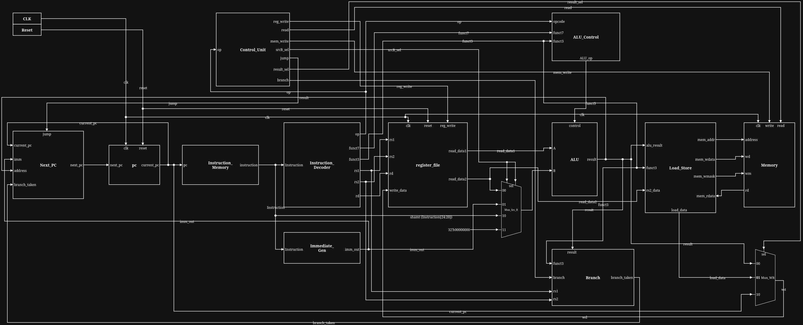

# RV32I Single-Cycle RISC-V CPU in SystemVerilog, with C++ Assembler and Verification

> An in-progress hardware/software co-design of a RISC-V CPU

[](https://github.com/HamzaAndishmand/rv32i/actions/workflows/ci.yml)


## Overview
This project is a single-cycle RV32I RISC-V processor implemented from scratch in SystemVerilog. Testbench runs under Verilator in CI on every push.

## Project Status
**Done:**
- Complete implementation of all instruction types (R, I, S, B, U, and J)
- Single-cycle datapath integrated
- ALU verified with self-checking testbench. Oracle is written from the spec, tested on corner cases and 1000+ random vectors
- C++ assembler that converts R-type and I-type instructions to 32-bit binary machine code
- CI pipeline under Verilator

**WIP:**
- Python program inspector and disassembler
- Testbench environment (End-of-test comparison, exhaustive verification of core modules, and mutation testing)

**Possible Extensions:**
- Python reference models with cocotb
- Two-pass assembler with error reporting
- Full core lockstep co-simulation

## Architecture


## Verification Philosophy

Modules are checked against a reference model. Each module's testbench drives the DUT with random inputs then compares the outputs against the oracle.

**Possible Extensions To Verification:**
-UVM, SVA, and functional coverage

## Build & Run

**Required**
- Verilator v5.050
- GNU Make

**Steps**
```bash
git clone https://github.com/HamzaAndishmand/rv32i.git
cd rv32i
make sim_verilator
```
**Expected output:**

```text
Total tests passed:        1000
Total tests failed:           0
random_num done
Total tests passed:        3240
Total tests failed:           0
check_corners done
- Testbench/ALU_tb.sv:184: Verilog $finish
- S i m u l a t i o n   R e p o r t: Verilator 5.050 2026-07-01
- Verilator: $finish at 52ns; walltime 0.009 s; speed 5.650 us/s
- Verilator: cpu 0.009 s on 1 threads; allocated 7 MB
```

To clean build artifacts:
```bash
make clean
```

## Known Issues
- CI only covers ALU testbench. More modules to be added as soon as the testbenches are complete.

